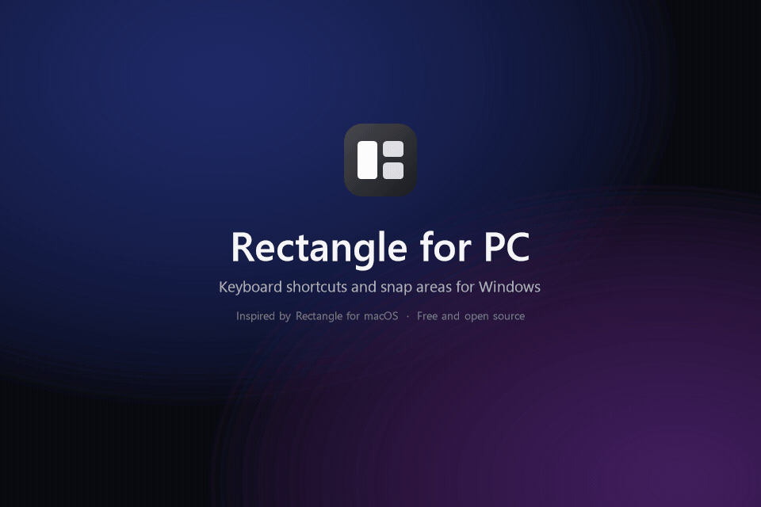
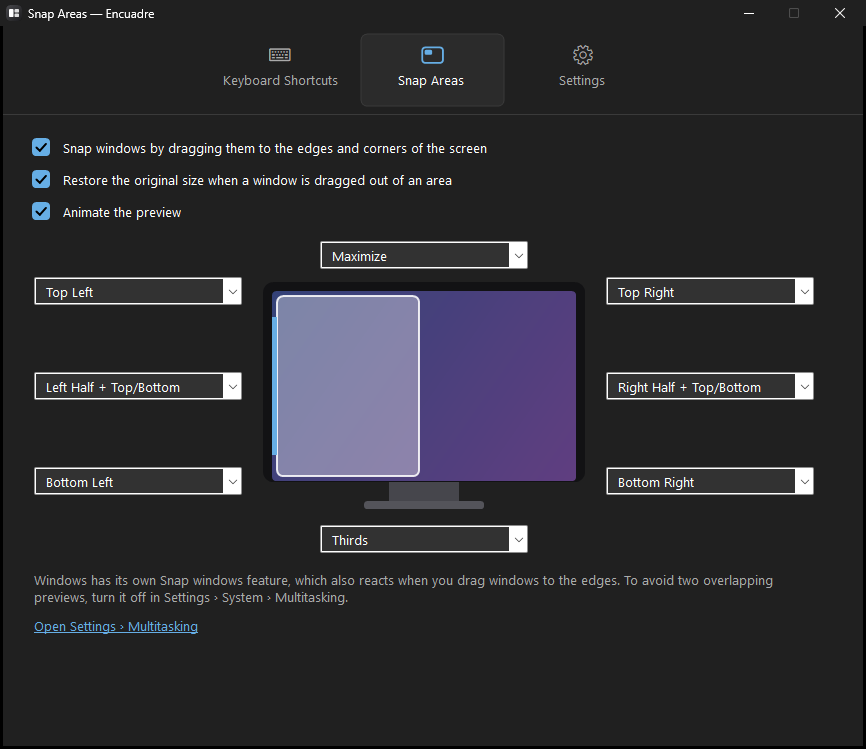
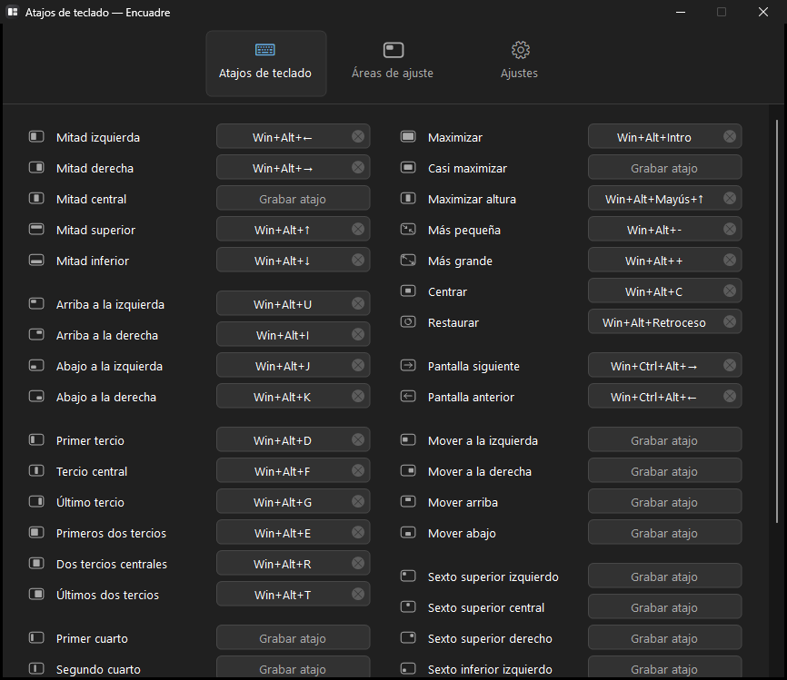
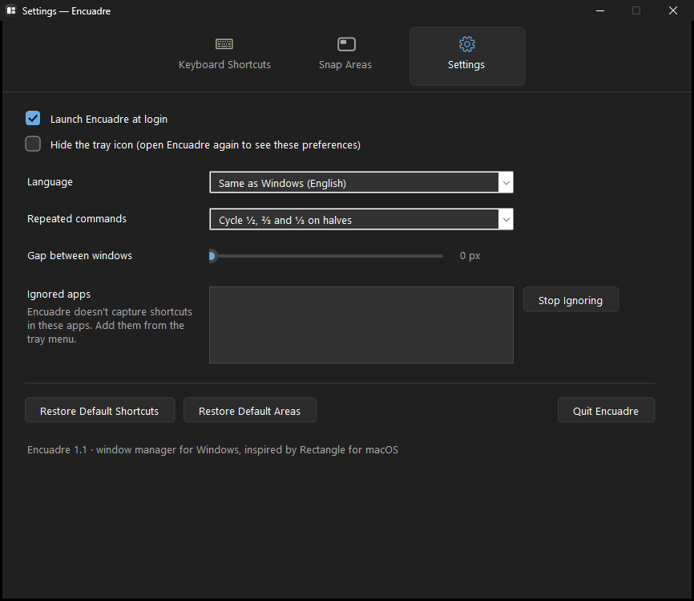

# Rectangle for PC

A window manager for Windows 10 and 11, modeled on [Rectangle](https://rectangleapp.com/) for macOS. Move and resize windows with keyboard shortcuts or by dragging them to the edges and corners of the screen.

Unofficial project, not affiliated with Rectangle or its authors.



## Features

- Halves, quarters, thirds, two-thirds, fourths and sixths, plus maximize, almost maximize, maximize height, center, larger/smaller and restore.
- Repeating a shortcut cycles sizes the same way Rectangle does: halves go ½ → ⅔ → ⅓, thirds and fourths step across the screen.
- Snap areas: drag a window to an edge or corner to get a preview and drop it into place. Each area can be reassigned.
- Move windows between monitors. Works with mixed DPI setups.
- Optional gap between windows, per-app exclusions, light and dark theme, start at login.
- Available in English, Spanish, Portuguese, French, German and Italian. It follows the Windows display language and falls back to English.
- Single executable, no installer, no dependencies beyond the .NET Framework 4.8 that ships with Windows.



## Default shortcuts

Rectangle's default layout, with `Win+Alt` in place of `Ctrl+Option`. Every shortcut can be changed in Preferences.



| Action | Shortcut |
| --- | --- |
| Left / right half | `Win+Alt+←` / `Win+Alt+→` |
| Top / bottom half | `Win+Alt+↑` / `Win+Alt+↓` |
| Top left / top right | `Win+Alt+U` / `Win+Alt+I` |
| Bottom left / bottom right | `Win+Alt+J` / `Win+Alt+K` |
| First / center / last third | `Win+Alt+D` / `Win+Alt+F` / `Win+Alt+G` |
| First / center / last two thirds | `Win+Alt+E` / `Win+Alt+R` / `Win+Alt+T` |
| Maximize | `Win+Alt+Enter` |
| Maximize height | `Win+Alt+Shift+↑` |
| Smaller / larger | `Win+Alt+-` / `Win+Alt+=` |
| Center | `Win+Alt+C` |
| Restore | `Win+Alt+Backspace` |
| Next / previous display | `Win+Ctrl+Alt+→` / `Win+Ctrl+Alt+←` |

AltGr is treated as Alt, never as Ctrl+Alt, so characters typed with AltGr keep working.

Some of these combinations replace Windows shortcuts while the app is running (for example `Win+Alt+R` and `Win+Alt+G` for Game Bar recording, `Win+Alt+K` for mic mute). Clear or reassign them in Preferences if you need those.

## Build

Requires Windows 10 or 11. The C# compiler included with the .NET Framework is enough; no Visual Studio or SDK needed.

```powershell
powershell -ExecutionPolicy Bypass -File build.ps1
```

This produces `Encuadre.exe` in the project folder. Run it and it lives in the system tray; click the icon to open Preferences.

## Languages

The app uses the Windows display language when it has a translation for it, and English otherwise. To pick a different one, open Preferences › Settings › Language.



All interface text lives in [`src/Lang.cs`](src/Lang.cs): one row per string, one column per language. To add a language, add its code and name to `Codes` and `Names` and a column to every row. The self-test reports any row with a missing translation.

## Notes

- Windows has its own Snap feature that also reacts to dragging windows to the edges. Turn it off in Settings › System › Multitasking › Snap windows to avoid two overlapping previews.
- Windows that run as administrator can only be moved if this app also runs as administrator.
- Settings are stored in `%APPDATA%\Encuadre\config.ini`.
- `Encuadre.exe --selftest result.txt` runs the built-in tests on a test window of its own and writes the results to a file.

## Project layout

| File | Contents |
| --- | --- |
| `src/Program.cs` | Entry point, self-test |
| `src/App.cs` | Tray icon, menu, start at login |
| `src/Hooks.cs` | Low-level keyboard and mouse hooks |
| `src/WindowOps.cs` | Layout calculations and window placement |
| `src/Snap.cs` | Snap areas and the drag preview |
| `src/Model.cs` | Actions, default shortcuts, configuration |
| `src/Prefs.cs` | Preferences window |
| `src/Theme.cs` | Colors, icons, light/dark theme |
| `src/Lang.cs` | Interface text in every language, language detection |
| `tools/demo/` | Draws `docs/demo.gif` frame by frame with the app's own layout code (`make-demo.ps1`, needs ffmpeg) |
| `src/Native.cs` | Win32 interop |

## Credits

Behavior and default shortcuts follow [Rectangle](https://github.com/rxhanson/Rectangle) by Ryan Hanson, released under the MIT license. This is an independent C# implementation for Windows and contains no code from Rectangle.

## License

[MIT](LICENSE)
